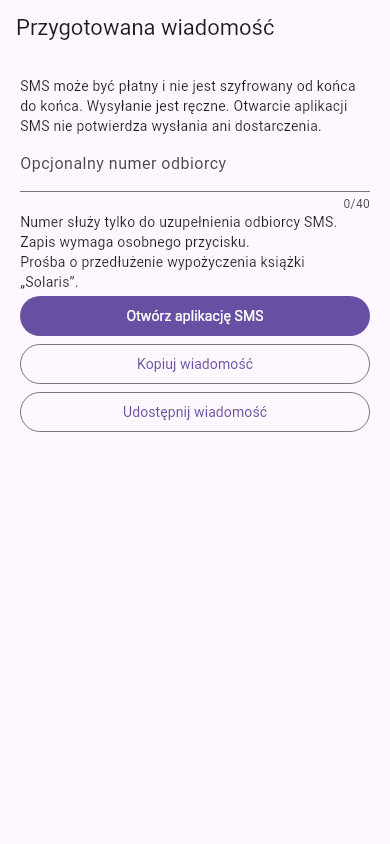
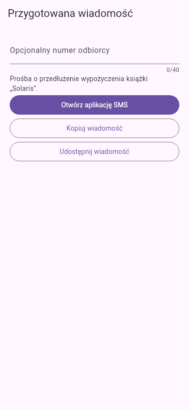
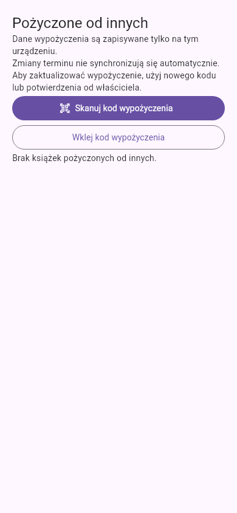
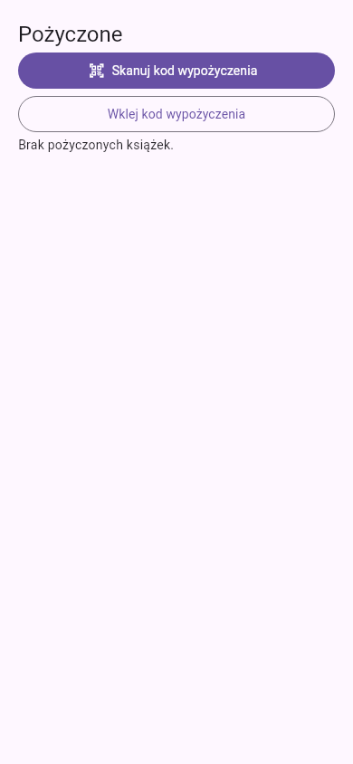
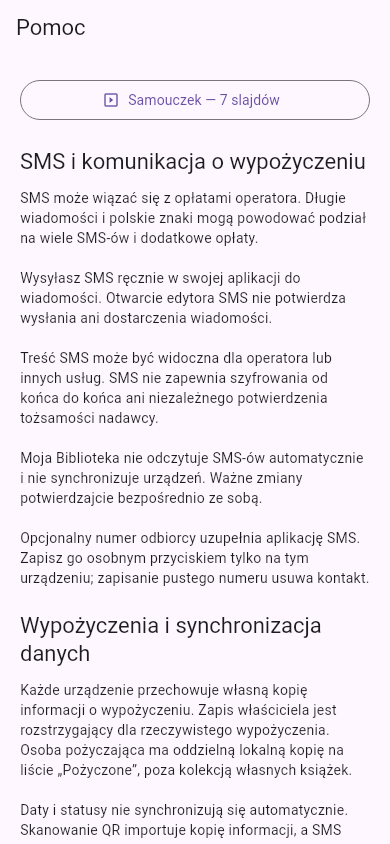

# Loan UI and Help cleanup — Task 23

Pomoc opens a scrollable page with SMS and local borrowing guidance, plus
Samouczek — 7 slajdów. The existing tutorial_completed_v1 preference and gate
are unchanged. Returning from Help preserves library search and book data.

Persistent SMS privacy and offline-copy paragraphs have moved off the SMS,
loan-message, QR and borrowed-list screens. QR import still previews untrusted
data and warns that it proves neither identity nor ownership. Manual sent-state,
date-change and local-deletion confirmations remain in place, as do composer
failure messages and unverified-delivery status feedback.

Presentation uses Pożyczone, Termin zwrotu (with relevant qualifiers),
Brak terminu zwrotu, and DD.MM.YYYY across owned and borrowed screens.
Data wypożyczenia still means the start of the loan.
No SQLite schema, protocol serialization, ownership, lending transaction or
reminder behavior changed. Only readable invitation instructions changed.

## Validation

Local Flutter 3.47.5 / Dart 3.13.4:

- flutter pub get — passed; lockfile unchanged.
- dart format lib test — passed.
- dart format --output=none --set-exit-if-changed lib test — passed.
- flutter analyze — no issues.
- flutter test — all 325 tests passed.
- flutter build apk --debug — passed.
- git diff --check — passed.

Tests cover existing-user Help access, seven-slide manual tutorial exits without
preference writes, persisted onboarding completion, library data and search
preservation, concise operational screens, essential Help content, navigation,
date labels, QR trust preview/cancellation, and 320×480 with 200% text scaling.
The full suite also retains SQLite, borrowing and messaging regression coverage.

## Before / after screenshots

These are raster captures of real Flutter widgets at 390×844 with Roboto and
Material icons, rendered by flutter test using matchesGoldenFile and
--update-goldens. They are widget screenshots, not physical-device captures.
Before screens use source from base commit 35643f1; after screens use Task 23.
The SMS fixture is a manually prepared message and the borrowed collection is
empty, so the removed static paragraphs are directly comparable.

| Screen | Before | After |
| --- | --- | --- |
| SMS preparation |  |  |
| Borrowed collection |  |  |

CI run links and the final commit SHA are recorded in the pull request.
No merge or application publication is part of this task.
